# Handwritten Digit Recognition with CNNs

A PyTorch-based deep learning project for classifying handwritten digits (0–9) using a Convolutional Neural Network (CNN). The project explores how different data augmentation techniques affect model performance and generalization.

## Project Overview

The project uses the [Kaggle Digit Recognizer dataset](https://www.kaggle.com/competitions/digit-recognizer), which contains 28×28 grayscale images of handwritten digits.

The main objectives are to:
- Build and train a CNN for handwritten digit classification.
- Explore different data augmentation techniques.
- Compare model performance across augmentation configurations.
- Evaluate classification performance using multiple metrics and visualizations.
- Investigate misclassified examples and potential dataset labeling issues.

## Dataset

| Split | Number of images | Description |
|---|---:|---|
| Training | 42,000 | Labeled images |
| Test | 28,000 | Unlabeled images |

Each image contains 784 pixel values, which are reshaped into 28×28 grayscale images. Pixel intensities range from 0 to 255.

## Methodology

### Data Preprocessing

- Reshape flattened pixel arrays into 28×28 images.
- Convert images to PyTorch tensors.
- Normalize pixel values to the range [-1, 1].
- Split the training data into training and validation sets, using stratification to preserve class distribution.

### Data Augmentation

Several augmentation techniques were implemented and evaluated:

| Technique | Description |
|---|---|
| Random Affine | Applies random rotations, translations, and scaling. |
| Random Erasing | Randomly removes a small region of the digit. |
| Morphological Transformation | Applies dilation or erosion to modify digit stroke thickness. |

The transformations were evaluated individually and in selected combinations to investigate their impact on classification performance.

### Model Architecture

The model is a CNN implemented using PyTorch, consisting of:
- Five convolutional layers with Batch Normalization and ReLU activation.
- A Max Pooling layer for spatial downsampling.
- Two fully connected layers.
- Dropout regularization before the output layer.
- Ten output units corresponding to the digit classes.

The model is trained using Cross-Entropy Loss and the AdamW optimizer. A learning rate scheduler and early stopping are used to support training and model selection.

## Experiments and Results

Each augmentation configuration was trained separately using the same general training and evaluation pipeline. The notebook contains the implementation of all transformations, but only the affine transformation is enabled in the final training configuration. The other transformations are commented out; their results below come from separate training runs.

### Performance Comparison

| Configuration | Validation Accuracy | Correct Predictions | Errors |
|---|---:|---:|---:|
| No Augmentation | 99.43% | 4,176 | 24 |
| Random Erasing | 99.38% | 4,174 | 26 |
| Dilation | 99.50% | 4,179 | 21 |
| Affine Transformation | **99.74%** | **4,189** | **11** |

*Results are from individual runs. The validation set contains 4,200 images.*

### Training and Validation Curves

The loss and accuracy curves provide insight into the model's learning progress, convergence, and potential overfitting.

#### No Augmentation

| Loss | Accuracy |
|---|---|
| 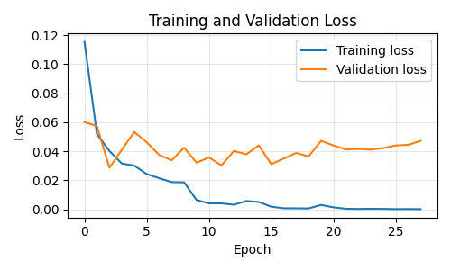 | 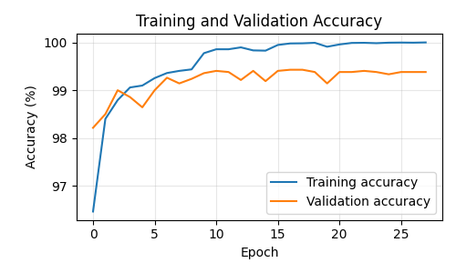 |

#### Random Erasing

| Loss | Accuracy |
|---|---|
| 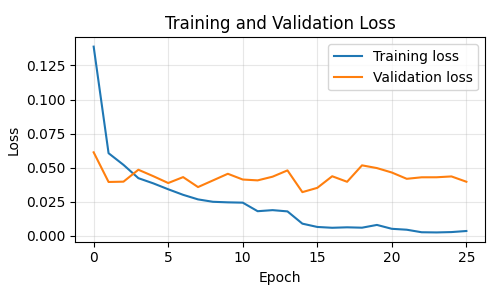 | 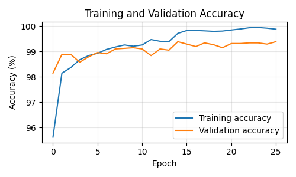 |

#### Dilation

| Loss | Accuracy |
|---|---|
| 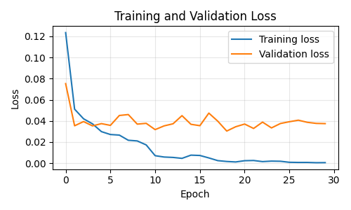 | 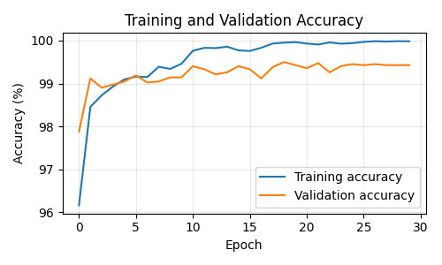 |

#### Affine Transformation

| Loss | Accuracy |
|---|---|
| 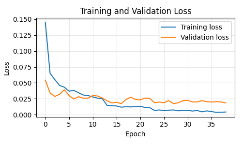 | 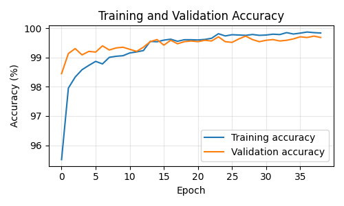 |

### Analysis of Training Curves

The training and validation curves provide insight into how the model learns and how well it generalizes to unseen data.

- **Convergence:** A decreasing loss and increasing accuracy indicate that the model is learning useful patterns. When both curves begin to stabilize, the model is approaching convergence.
- **Overfitting:** If training loss continues to decrease while validation loss starts increasing, the model may be overfitting. A widening gap between training and validation accuracy can indicate the same problem.
- **Plateauing:** When both training and validation metrics stop improving, the model may have reached a plateau. This can indicate that further training with the same configuration is unlikely to provide significant improvements.
- **Learning rate reduction and early stopping:** The learning rate scheduler reduces the learning rate when validation loss stops improving, allowing the optimizer to make smaller updates. Early stopping terminates training when validation accuracy fails to improve for the specified number of epochs.

The best checkpoint is selected based on validation accuracy rather than simply using the final training epoch. This helps retain the model with the best observed validation performance.

### Confusion Matrices

Confusion matrices show how predictions are distributed across the ten digit classes and help identify which digits are most frequently confused.

### Confusion Matrices

<table>
  <tr>
    <td align="center">
      <strong>No Augmentation</strong><br>
      
    </td>
    <td align="center">
      <strong>Random Erasing</strong><br>
      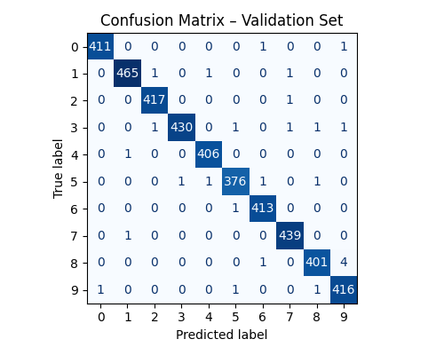
    </td>
  </tr>
  <tr>
    <td align="center">
      <strong>Dilation</strong><br>
      
    </td>
    <td align="center">
      <strong>Affine Transformation</strong><br>
      
    </td>
  </tr>
</table>

The confusion matrices show that most predictions are concentrated along the main diagonal, indicating that the model correctly classifies the majority of images.

Some digits are naturally more difficult to distinguish because of similarities in handwriting. Commonly confused pairs include:

- **3 and 5:** Some handwritten versions have similar curves and stroke patterns.
- **4 and 9:** Depending on how they are written, their upper sections can look similar.
- **7 and 1:** Certain handwriting styles make these digits difficult to distinguish.
- **8 and 9:** Similar loops and closed shapes can lead to confusion.
- **5 and 6:** Their curved lower sections can sometimes appear similar.

These similarities help explain some of the remaining classification errors. However, the actual confusion patterns vary depending on the dataset and should be interpreted from the off-diagonal values in each matrix.

### Misclassified Examples

Inspecting misclassified images provides additional insight into model errors, particularly for visually similar or ambiguously written digits.

### Misclassified Examples

<table>
  <tr>
    <td align="center">
      <strong>No Augmentation</strong><br>
      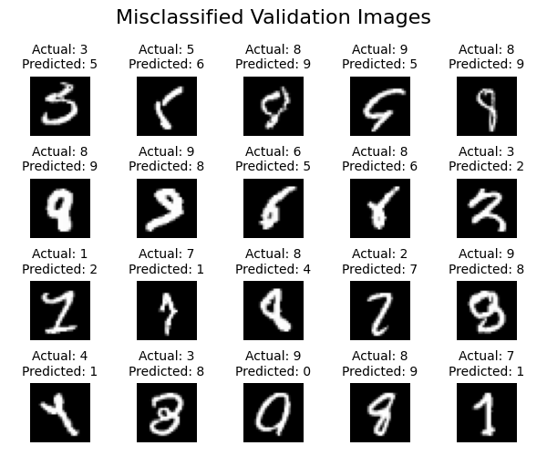
    </td>
    <td align="center">
      <strong>Random Erasing</strong><br>
      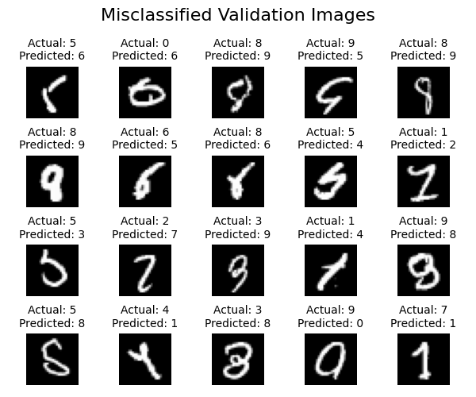
    </td>
  </tr>
  <tr>
    <td align="center">
      <strong>Dilation</strong><br>
      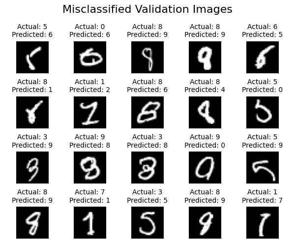
    </td>
    <td align="center">
      <strong>Affine Transformation</strong><br>
      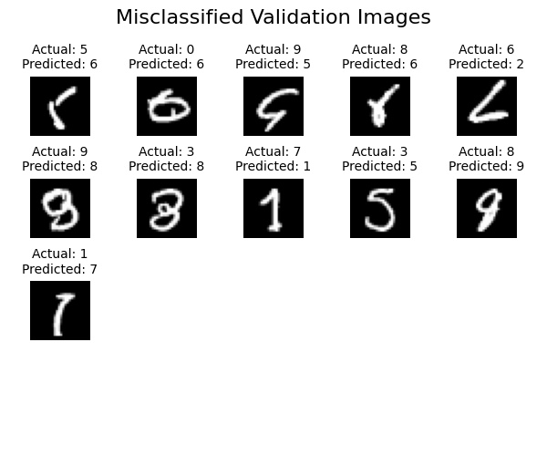
    </td>
  </tr>
</table>

## Discussion

The affine transformation configuration achieved the highest validation accuracy among the tested approaches (99.74%). This suggests that introducing moderate variations in digit position, orientation, and scale can improve generalization.

Random erasing and dilation did not outperform the model trained without augmentation. Combining multiple transformations also did not necessarily improve performance, indicating that the choice and intensity of augmentation are important.

Inspection of misclassified examples also revealed images whose assigned labels appear inconsistent with the digits shown. Such potential labeling errors can affect both training and evaluation: mislabeled training examples provide incorrect supervision, while mislabeled validation examples can make the measured accuracy lower than the model's actual recognition ability.

These findings should be interpreted with some caution, as each configuration was evaluated using a single training run. Model initialization, data shuffling, augmentation randomness, architecture, and training hyperparameters can all influence the results.

## Technologies Used

- Python
- PyTorch
- NumPy
- Pandas
- Matplotlib
- Scikit-learn
- Torchvision
- Jupyter Notebook

## Project Structure

```text
digit-recognizer/
│
├── notebook/
│   └── digit-recognizer.ipynb
│
├── data/
│   └── results/
│       ├── no_augmentation/
│       ├── erasing/
│       ├── dilation/
│       ├── affine/
│       └── affine_dilation/
│
├── requirements.txt
└── README.md
```

## How to Run

1. Clone the repository:

   ```bash
   git clone https://github.com/jezte/digit-recognizer.git
   cd digit-recognizer
   ```

2. Install the required dependencies:

   ```bash
   pip install -r requirements.txt
   ```

3. Open the notebook and run the cells in order.

   The notebook was developed in Kaggle, so update the dataset paths if running it in a different environment.

## Future Improvements

- Repeat experiments using multiple random seeds for more reliable comparisons.
- Explore alternative CNN architectures and hyperparameter configurations.
- Investigate potential mislabeled samples in the dataset.
- Evaluate additional augmentation strategies and parameter ranges.
- Compare model performance on an independent dataset.
